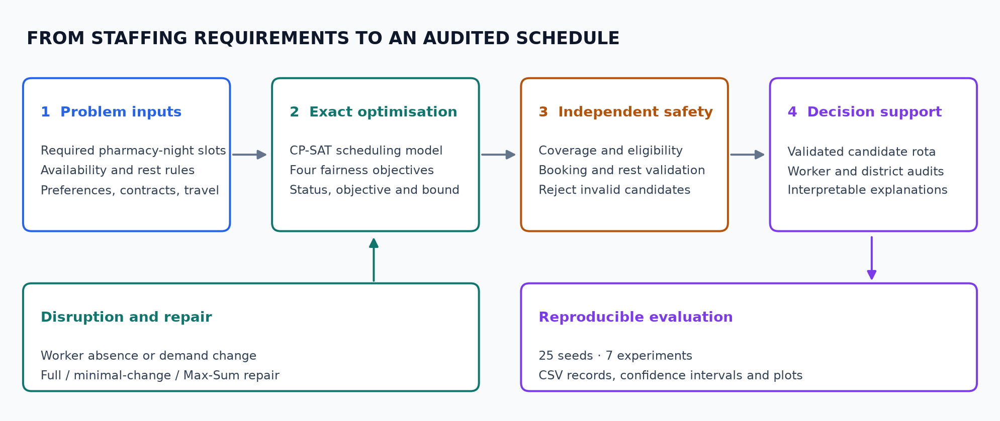
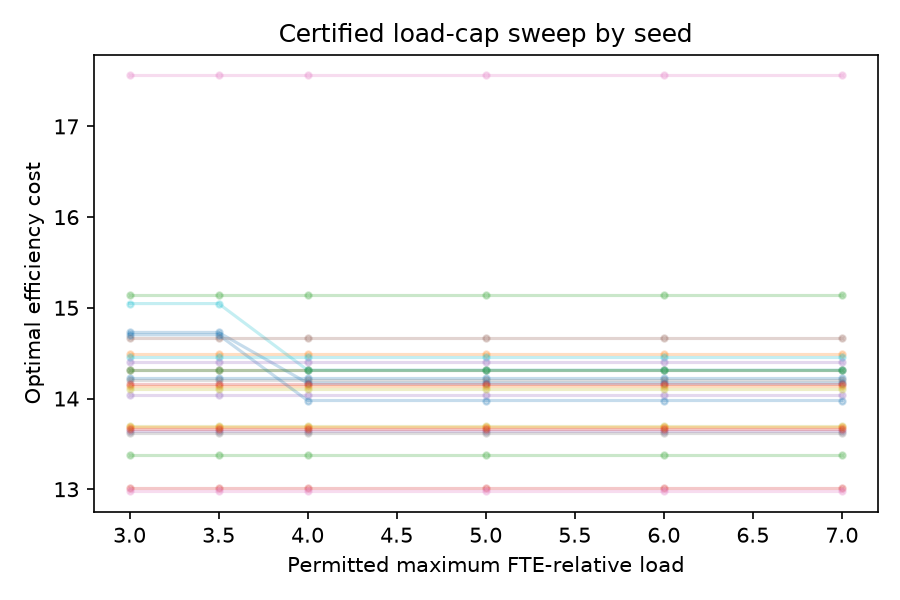
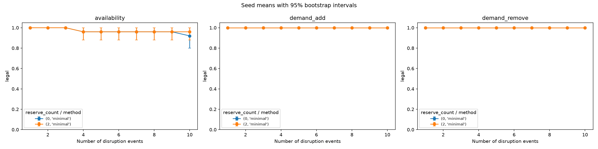

<div align="center">

# Fair and Constraint-Aware Pharmacy Shift Scheduling

**A Computational Perspective on Fairness, Robustness, and Explainability**

**[Kawsar Farooq (Kasa)](https://github.com/kawsarfarooq)**


[](https://github.com/kawsarfarooq/Fair-Pharmacy-Scheduling-Ethics-in-AI/actions/workflows/tests.yml)

[Overview](#overview) | [Installation](#installation) | [Dataset](#dataset) | [Experiments](#run-experiments) | [Results](#experimental-results) | [References](#references)

</div>

## Overview

We implement a constraint-based decision-support system for pharmacy night-shift scheduling, examining how fairness, robustness and explainability affect allocation decisions. Our implementation includes exact optimisation with Google OR-Tools CP-SAT, worker and district fairness audits, disruption repair, independent safety validation, and explanations of scheduling decisions. Max-Sum and greedy/local search provide algorithmic comparisons.



*Scheduling pipeline: staffing requirements and worker constraints, exact optimisation, independent validation, and an auditable candidate rota. Availability or demand changes trigger repair; reproducible experiments evaluate the resulting trade-offs.*

- **Fairness:** four objective definitions, contract-normalised workloads, worker/district equity and efficiency trade-offs.
- **Robustness:** worker absences, demand changes, reserve workers, and full or minimal-change repair.
- **Explainability:** local contrastive answers, objective breakdowns, counterfactual re-solves and minimal policy conflicts.
- **Experiment tracking:** seeded scenarios, solver certificates, configuration manifests, CSV records, confidence intervals and plots.

## Folder structure

```text
.
|-- src/
|   |-- fair_scheduling/       # Exact solver, audits, repair and explanations
|   `-- pharmacy_dcop/         # Reference factor-graph implementation
|-- experiments/
|   |-- f1_... / f2_... / f3_...   # Fairness and efficiency
|   |-- r1_... / r2_... / r3_...   # Robustness and repair
|   |-- x1_...                    # Explanation comparison
|   `-- trustworthy_results/      # Completed CSVs, summaries and plots
|-- data/processed/            # Compact Bologna infrastructure snapshot
|-- docs/                      # Usage notes, methodology and badges
|-- report/                    # Project report, protocol and results
|-- scripts/                   # Data preparation and README assets
|-- tests/                     # Automated validation
|-- .github/workflows/         # Continuous integration
`-- pyproject.toml
```

## Installation

Use **Python 3.10 or later**. The project runs on CPU and uses OR-Tools, NumPy, pandas and Matplotlib.

```bash
git clone https://github.com/kawsarfarooq/Fair-Pharmacy-Scheduling-Ethics-in-AI.git
cd Fair-Pharmacy-Scheduling-Ethics-in-AI
python -m venv .venv
source .venv/bin/activate
python -m pip install --upgrade pip
python -m pip install -e '.[dev]'
```

On Windows PowerShell, activate with `.\.venv\Scripts\Activate.ps1`. Repository access requires an authenticated account while the repository is private.

## Dataset

The main evaluation uses **controlled synthetic scheduling instances**, with seeds **0-24**. Workers have availability, disliked nights, home locations and contract hours; synthetic group labels support outcome audits and are excluded from the solver objectives.

| Setting | Recorded configuration |
|---|---|
| Pharmacies / workers | 2 / 8 |
| Planning horizon / districts | 7 nights / 2 synthetic districts |
| Contract FTE | 0.5 or 1.0 |
| Shift types | Weekday, weekend and holiday |
| Preference penalty / travel weight | 3 / 0.2 per km |
| Replicates | 25 seeds |
| Solver budget / search workers | 2 seconds per solve / 1 worker |

The repository also includes a Bologna-grounded case-study loader and processed public pharmacy/demographic data. Worker attributes and service requirements remain synthetic. These public records are infrastructure inputs, not an official night-duty rota. [Data sources and interpretation](data/README.md).

## Run experiments

### Complete evaluation

```bash
python experiments/run_trustworthy.py --seeds 25 --time-limit 2
python report/update_results.py
```

This reproduces the recorded configuration. Each experiment writes individual observations, seed-level summary CSVs, 95% bootstrap intervals and plots to `experiments/trustworthy_results/`. A manifest records package versions, seeds, solver settings and source hashes.

### Quick pipeline check

```bash
python experiments/run_trustworthy.py --seeds 2 --time-limit 1 --output experiments/trustworthy_smoke
```

The shorter run checks the full workflow. It does not replace the 25-seed evaluation, and its smaller solve budget can produce different certificate states.

### Individual experiments

```bash
python experiments/f1_fairness_definitions.py --seeds 25 --time-limit 2
```

| Experiment | Evaluation |
|---|---|
| F1 | Four fairness definitions and matched-objective solver comparison |
| F2 | Load-cap frontier, price of fairness and weight sensitivity |
| F3 | Group/district audits and availability-proxy ablation |
| R1 | 1-10 availability or demand changes, with and without reserves |
| R2 | Full, minimal-change, warm and cold repair |
| R3 | Strategic preference declarations and declaration caps |
| X1 | Explanation faithfulness, size, runtime and stability |

All seven scripts accept `--seeds`, `--time-limit` and `--output`. [Evaluation protocol](report/evaluation.md).

### Generate a schedule

```python
from fair_scheduling import solve, publish_schedule, audit
from fair_scheduling.scenarios import audit_scenario

instance = audit_scenario(seed=0)
result = solve(instance, fairness="variance", time_limit=30)
print(result.status, result.proven_optimal)

if result.status in {"OPTIMAL", "FEASIBLE"}:
    schedule = publish_schedule(instance, result.assignment)
    print(audit(instance, schedule))
```

The publication gate checks coverage, eligibility, availability, booking and rest conflicts. `FEASIBLE` provides a legal incumbent without proof of optimality; `INFEASIBLE` proves inconsistency in the encoded model; `UNKNOWN` establishes neither. [Detailed usage, objectives and repair examples](docs/USAGE.md).

## Experimental results

Our completed evaluation contains **seven experiments, 25 seeds and 4,100 raw result rows**. Results below are descriptive means from the recorded archive.

### Fairness and efficiency

Let each worker's burden be their number of assigned shifts divided by their contract FTE. The objectives express different priorities: total efficiency cost, a weighted maximum burden, workload dispersion, or successive worst burdens followed by efficiency.

| Fairness objective | FTE Jain index | Efficiency cost |
|---|---:|---:|
| Utilitarian | 0.6979 | 14.1745 |
| Egalitarian | 0.9329 | 14.2552 |
| Variance | 0.9764 | 14.2552 |
| Lexicographic | 0.9764 | 14.2552 |

*Higher Jain values indicate more equal FTE-relative workloads. Efficiency cost combines preferences and travel, excluding fairness penalties. These means describe this synthetic scenario; they do not establish one universally best fairness definition.*



*Certified efficiency optima under sampled maximum FTE-load caps, shown separately by seed. Infeasible caps remain in the CSV records. The sampled sweep does not enumerate every Pareto-efficient schedule.*

### Solver comparison

| Solver | Mean cost | Mean gap to certified optimum |
|---|---:|---:|
| CP-SAT | 15.6743 | 0.0000 |
| Max-Sum | 16.6970 | 1.0227 |
| Greedy + local search | 17.2786 | 1.6043 |

*All three methods use the same raw-count variance objective in this comparison. Gaps are absolute costs against certified references; they are not percentages or claims about all instance sizes.*

### Disruption and repair



*Legality after 1-10 availability or demand perturbations, with and without two reserve workers. Error bars show seed-level 95% bootstrap intervals.*

| Repair strategy | Mean stability | Mean cost increase over full re-solve |
|---|---:|---:|
| Full re-optimisation | 0.2270 | 0.0000 |
| Minimal-change CP-SAT | 0.6054 | 2.2120 |
| Cold Max-Sum | 0.4386 | 0.7782 |
| Warm Max-Sum | 0.4374 | 0.7646 |

*Quality means use legal repair rows only. Stability is the fraction of shared slots retaining their assigned worker. Minimal-change repair prioritises continuity and can sacrifice objective quality; legality failures remain in the full records.*

### Explanation comparison

| Technique | Question answered |
|---|---|
| Local contrastive | Why this worker when all other assignments stay fixed? |
| Objective breakdown | Which worker-level costs and objective terms account for the score? |
| Counterfactual re-solve | What changes elsewhere if another worker must take this slot? |
| Minimal conflict | Which policies conflict with forcing the alternative assignment? |

Local fixed-rota feasibility agrees with global feasibility in **68.0%** of the tested candidate questions. A local conflict therefore needs its fixed-rota qualification. Conflict sets are deletion-minimal when certified, not necessarily smallest in cardinality. [Full explanation evaluation](report/results.md#explanation-scope).

### Validation

- **33 automated tests** cover exact objectives against enumeration, safety checks, repairs, conflict cores, rational FTE/travel costs and district equity, alongside scheduling/data regression checks.
- GitHub Actions runs the test suite on **Python 3.11 and 3.12**.
- Seven complete experiment datasets retain solver certificates, infeasible outcomes and reproducibility metadata.

[Experiment records](experiments/trustworthy_results/) | [Configuration manifest](experiments/trustworthy_results/manifest.json) | [Complete results](report/results.md) | [Continuous integration](https://github.com/kawsarfarooq/Fair-Pharmacy-Scheduling-Ethics-in-AI/actions)

## Development

```bash
python -m pytest -q
python scripts/generate_readme_assets.py
```

The figure generator refreshes the methodology diagram and local badges. Measured result plots are produced by the experiment scripts.

This is a research prototype with a simplified rest model and synthetic employee attributes. It does not establish operational readiness, complete labour-law compliance or real-world demographic fairness. [Project report](report/PROJECT_REPORT.md) | [Design and evaluation](report/design_and_evaluation.md) | [Ethical analysis and limitations](report/ethics.md).

## References

1. Google OR-Tools. [CP-SAT solver documentation](https://developers.google.com/optimization/cp/cp_solver).
2. Google OR-Tools. [Assumptions and infeasibility example](https://github.com/google/or-tools/blob/stable/ortools/sat/samples/assumptions_sample_sat.py).
3. European Commission AI HLEG (2019). [Ethics Guidelines for Trustworthy AI](https://digital-strategy.ec.europa.eu/en/library/ethics-guidelines-trustworthy-ai).
4. European Commission AI HLEG (2020). [Assessment List for Trustworthy Artificial Intelligence](https://digital-strategy.ec.europa.eu/en/library/assessment-list-trustworthy-artificial-intelligence-altai-self-assessment).
5. Comune di Bologna. [Public pharmacy and district data sources](data/README.md). Source attribution and data interpretation are documented with the processed snapshot.
