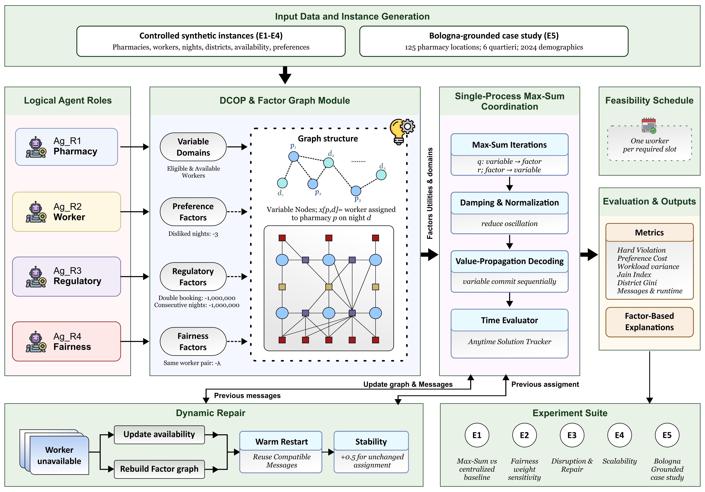

> Archived Multi-Agent Systems README. Relative links were adapted for this report directory.

# A Multi-Agent System for Fair and Constraint-Aware Pharmacy Night-Shift Scheduling

A multi-agent scheduling framework that models pharmacy night-shift allocation
as a Distributed Constraint Optimization Problem (DCOP) and coordinates
assignments with Max-Sum message passing on a factor graph.

Each required pharmacy-night slot receives one eligible worker. The model
combines worker availability, geographic eligibility, preferences, labour
constraints, workload fairness, and schedule stability after disruptions.

## Scope

Pharmacy, Worker, Regulatory, and Fairness roles are represented as logical
agents with distinct responsibilities. The current implementation executes
these roles in one Python process. It studies logically decentralised ownership
and message-passing coordination, but does not claim physically distributed
execution, network privacy, or fault tolerance.

The project supports two input modes:

- **Controlled synthetic instances (E1-E4):** configurable pharmacies,
  workers, nights, districts, availability, and preferences.
- **Bologna-grounded case study (E5):** 125 public pharmacy locations, six
  municipal districts, and 2024 demographic data, combined with synthetic
  workers, availability, preferences, and night-service requirements.

The Bologna case is a reproducible experimental scenario, not an official
night-duty schedule.

## System Architecture



The pipeline prepares an instance, constructs a DCOP factor graph, runs
Max-Sum, decodes a complete assignment, and evaluates the resulting schedule.
When a worker becomes unavailable, the repair module updates the instance,
reuses compatible messages, and rewards unchanged assignments.

## DCOP Model

For every required pharmacy-night slot, the model creates a worker-valued
decision variable:

```text
x[p,d] = worker assigned to pharmacy p on night d
```

Its domain contains only workers who are available and geographically eligible
for that slot. The factor graph then represents the remaining requirements:

| Component | Representation | Implemented utility |
|---|---|---:|
| Coverage | One variable for every required slot | Encoded structurally |
| Availability and geographic eligibility | Variable domain | Ineligible values removed |
| Worker preference | Unary factor | `-3` for a disliked night |
| No double booking | Hard binary factor | `-1,000,000` for the same worker on the same night |
| Consecutive-night rest | Hard binary factor | `-1,000,000` for the same worker on adjacent nights |
| Workload fairness | Soft binary factor | `-lambda` for a legally repeatable same-worker pair |
| Repair stability | Unary repair factor | `+0.5` for retaining the previous assignment |

For a fixed number of required slots, minimising workload variance is
equivalent, up to an additive constant and positive scaling, to penalising
pairs of shifts assigned to the same worker. This allows the global fairness
objective to be represented using binary factors rather than one expensive
high-arity factor.

| Logical role | Responsibility |
|---|---|
| **Pharmacy role** | Owns pharmacy-night decision variables and repair-stability factors |
| **Worker role** | Contributes availability and disliked-night information |
| **Regulatory role** | Contributes no-double-booking and consecutive-night-rest factors |
| **Fairness role** | Contributes pairwise workload-equity factors |

## Max-Sum and Dynamic Repair

The solver performs synchronous variable-to-factor and factor-to-variable
message updates. Its practical mechanisms include:

- damping with coefficient `0.5` to reduce oscillation;
- mean normalisation to control numerical growth;
- seeded symmetry breaking for reproducible tie handling;
- independent and value-propagation decoding;
- anytime retention of the best complete assignment encountered;
- an independent evaluator for feasibility and schedule quality.

Dynamic repair handles worker unavailability by rebuilding the affected model,
reusing messages from compatible binary factors, and adding the `+0.5`
stability reward. The explanation module reports local eligibility,
preference, regulatory, workload, and alternative-assignment information. Its
explanations are post-hoc local comparisons and do not prove global optimality.

## Repository Structure

```text
src/pharmacy_dcop/
  model.py          entities, domains, and synthetic instance generation
  real_data.py      Bologna data preparation and hybrid E5 construction
  factor_graph.py   variable, unary-factor, and binary-factor construction
  maxsum.py         Max-Sum, damping, normalisation, and decoding
  baseline.py       centralised greedy and local-search heuristic
  dynamics.py       disruptions, warm restart, and stability utility
  explain.py        factor-based local assignment explanations
  metrics.py        feasibility, utility, variance, Jain, and district Gini
experiments/
  run_experiments.py       E1-E4 controlled experiments
  run_real_case_study.py   E5 Bologna-grounded case study
  results.csv              recorded E1-E4 results
  results_real.csv         recorded E5 results
scripts/
  prepare_bologna_data.py  reproducible public-data preparation
data/
  processed/               versioned compact Bologna data snapshot
  README.md                sources, licences, and interpretation limits
tests/                     regression and model-consistency tests
docs/images/               architecture figure used in this README
```

## Installation

Python 3.10 or later is required.

```powershell
python -m venv .venv
.\.venv\Scripts\Activate.ps1
python -m pip install -e ".[dev]"
```

On Linux or macOS, activate the environment with
`source .venv/bin/activate`.

## Running the Project

Run the test suite:

```powershell
python -m pytest
```

Run the controlled experiments E1-E4:

```powershell
python experiments/run_experiments.py
```

Run the Bologna-grounded case study E5 using the versioned processed data:

```powershell
python experiments/run_real_case_study.py
```

To rebuild the processed Bologna snapshot, first place the official downloads
in `data/raw/` as described in [`data/README.md`](../data/README.md), then run:

```powershell
python scripts/prepare_bologna_data.py
```

Raw downloads are intentionally ignored by Git. The compact processed tables
needed to reproduce E5 are versioned in `data/processed/`.

## Minimal Example

```python
from pharmacy_dcop import (
    MaxSum,
    build_factor_graph,
    disrupt,
    generate_instance,
    global_utility,
    repair,
    report,
)

instance = generate_instance(
    n_pharmacies=10,
    n_workers=28,
    horizon=14,
    seed=42,
)
graph = build_factor_graph(instance)
solver = MaxSum(graph, damping=0.5, seed=1)

schedule, utility, trace = solver.run(
    iterations=50,
    evaluator=lambda assignment: global_utility(instance, assignment),
)
print(report(instance, schedule))

# Inject one worker-unavailability event and repair the schedule.
slot = (0, 3)
disrupt(instance, wid=schedule[slot], day=slot[1])
repaired, repair_stats, solver = repair(
    instance,
    schedule,
    iterations=20,
    prev_solver=solver,
)
print(repair_stats)
```

## Experimental Evaluation

| Experiment | Purpose | Configuration |
|---|---|---|
| **E1** | Max-Sum versus the centralised heuristic | 10 pharmacies, 28 workers, 14 nights |
| **E2** | Fairness-weight sensitivity | 8 pharmacies, 24 workers, 10 nights |
| **E3** | Sequential disruption and warm-start repair | 80 slots, three unavailability events |
| **E4** | Runtime and message-count growth | 42-252 slots |
| **E5** | Bologna-grounded case study | 8 required locations/night, 24 synthetic workers, 14 nights |

### Recorded Results

All reported configurations produced schedules with zero hard-constraint
violations.

| Result | Observation |
|---|---|
| **E1** | Max-Sum obtained utility `-282`, preference cost `0`, Jain index `0.9943`, runtime `11.73 s`, and `1,946,000` algorithmic messages. The centralised heuristic obtained utility `-284`, preference cost `3`, Jain index `0.9972`, and runtime `3.24 s`. |
| **E2** | Increasing the fairness weight from `0` to `0.5` reduced workload variance from `0.889` to `0.222` and increased the Jain index from `0.9259` to `0.9804`. At weight `5`, preference cost increased to `6` without further fairness improvement. |
| **E3** | All three repairs restored feasibility and retained between `81.2%` and `98.8%` of previous assignments. |
| **E4** | From 42 to 252 slots, runtime increased from `0.6 s` to `44.5 s` and message count from `103,320` to `3,795,120`. |
| **E5** | The 112-slot case produced utility `-208`, workload variance `0.2222`, Jain index `0.9899`, and district Gini approximately `0.0258` with Max-Sum. |

Message counts measure simulated algorithmic coordination, not physical network
traffic. The centralised baseline is a heuristic and does not provide a
certified optimum.

## Evaluation Limitations

- Max-Sum is approximate on the cyclic factor graphs used here; convergence
  and global optimality are not guaranteed.
- Logical agent roles run in one Python process rather than on physically
  distributed nodes.
- Each reported configuration uses one seeded instance and one timing run.
- Warm restart is demonstrated but is not compared directly with cold restart.
- E5 uses public geography and demographics but synthetic workers,
  availability, preferences, and night-service requirements.

## Selected References

- Farinelli, Rogers, Petcu, and Jennings, *Decentralised coordination of
  low-power embedded devices using the Max-Sum algorithm*, AAMAS 2008.
- Fioretto, Pontelli, and Yeoh, *Distributed Constraint Optimization Problems
  and Applications: A Survey*, JAIR 2018.
- Kschischang, Frey, and Loeliger, *Factor Graphs and the Sum-Product
  Algorithm*, IEEE Transactions on Information Theory, 2001.
- Jain, Chiu, and Hawe, *A Quantitative Measure of Fairness and Discrimination
  for Resource Allocation in Shared Computer Systems*, 1984.

Public-data sources and licences for E5 are documented in
[`data/README.md`](../data/README.md).
