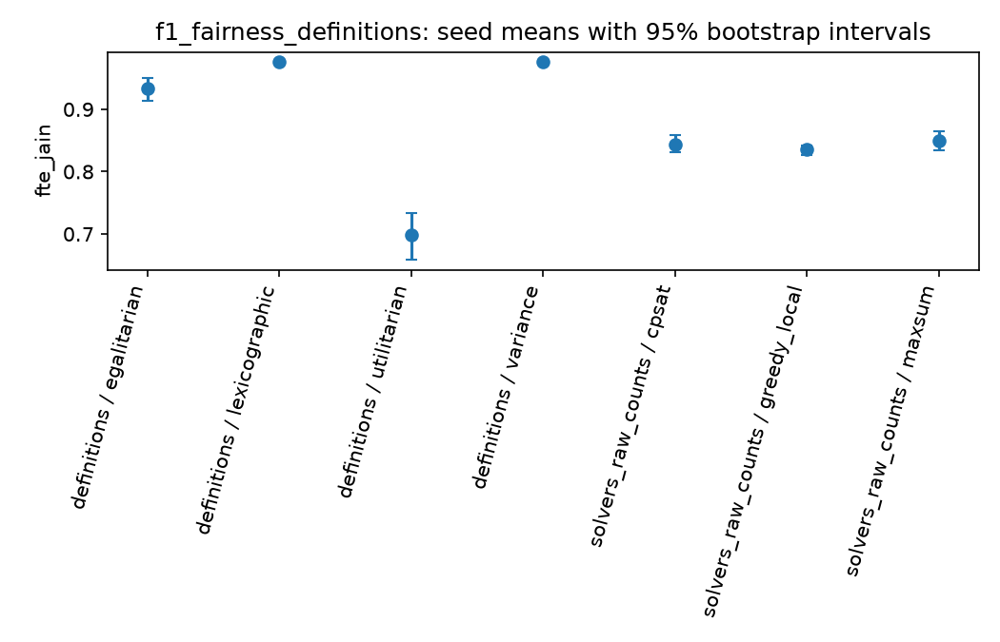
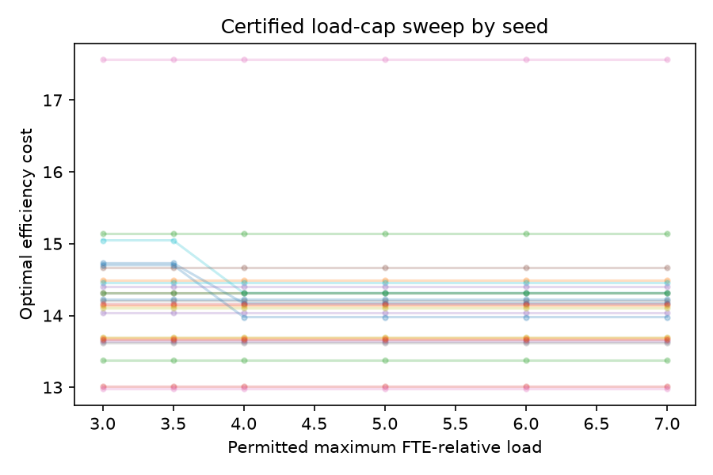
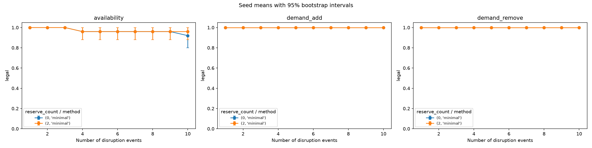

# Recorded evaluation results

The recorded run uses seeds 0-24, a two-second CP-SAT budget per solve and one
search worker. It contains **4,100 raw rows** across seven experiments.
See the [protocol](evaluation.md), [configuration manifest](../experiments/trustworthy_results/manifest.json)
and individual/summary CSVs for the definitions, uncertainty intervals and scope.
The tables below give descriptive means; they are not statistical superiority tests.

## Certificates and coverage

| experiment | rows | seeds | statuses |
| --- | --- | --- | --- |
| f1_fairness_definitions | 175 | 25 | {'OPTIMAL': 125, 'HEURISTIC': 50} |
| f2_pareto_front | 500 | 25 | {'OPTIMAL': 450, 'INFEASIBLE': 50} |
| f3_group_audit | 200 | 25 | {'OPTIMAL': 200} |
| r1_stress_test | 1500 | 25 | {'OPTIMAL': 1485, 'INFEASIBLE': 15} |
| r2_repair_strategies | 1000 | 25 | {'HEURISTIC': 500, 'OPTIMAL': 484, 'INFEASIBLE': 16} |
| r3_strategic_prefs | 100 | 25 | {'OPTIMAL': 100} |
| x1_explanation_comparison | 625 | 25 | {'OPTIMAL': 332, 'INFEASIBLE': 68} |

Heuristic rows cannot have exact-solver certificates. Explanation rows for local
and breakdown methods have no CP-SAT status. Infeasible load caps and disrupted
rotas are retained; they are expected experimental outcomes, not exceptions that
were removed from the data. A certificate applies only to the encoded model.

## Different ethical definitions

| method | fte_jain | workload_variance | district_gini | district_fte_gini | efficiency_cost |
| --- | --- | --- | --- | --- | --- |
| egalitarian | 0.9329 | 0.6475 | 0.0200 | 0.0370 | 14.2552 |
| lexicographic | 0.9764 | 0.4375 | 0.0200 | 0.0370 | 14.2552 |
| utilitarian | 0.6979 | 1.0575 | 0.0114 | 0.0376 | 14.1745 |
| variance | 0.9764 | 0.4375 | 0.0200 | 0.0370 | 14.2552 |

Higher Jain values indicate more equal FTE-relative workloads. Efficiency here
is preference cost plus travel cost, excluding the fairness penalty; audit travel
uses unrounded distance, differing from solver costs by at most rounding error.
The utilitarian result distributes burden less equally. Variance and
lexicographic fairness can achieve similar aggregate fairness on this small
scenario while expressing different normative priorities. This does not imply
that their solutions coincide on all inputs or that Jain is a complete fairness
criterion. The weighted egalitarian cost includes a different fairness term, so
objective values from different definitions should not be directly ranked.

## Shared-objective algorithm comparison

| method | cost | cost_gap |
| --- | --- | --- |
| cpsat | 15.6743 | 0.0000 |
| greedy_local | 17.2786 | 1.6043 |
| maxsum | 16.6970 | 1.0227 |

These costs use the same raw-count variance objective. Exact reference gaps are
computed only against certified optima. Both heuristic methods have positive
mean cost gaps in this scenario; this is not a claim about all problem sizes.

The cap sweep distinguishes infeasibility from optimal efficiency under a cap.
Its eight sampled caps do not enumerate the complete Pareto set. Price ratios
depend on the explicitly declared service-benefit scale; consult absolute extra
costs as well. Group audit results are synthetic outcome differences, not findings
about actual carers or pharmacy workers.

## Repair and robustness

The following quality means use **legal repair rows only**. Legality rates and
failures remain in the raw and summary CSVs. All methods use the same initial rota
and disruption sets; stability concerns shared required slots.

| method | stability | objective_loss_vs_full | seconds |
| --- | --- | --- | --- |
| full | 0.2270 | 0.0000 | 0.0145 |
| maxsum_cold | 0.4386 | 0.7782 | 0.0567 |
| maxsum_warm | 0.4374 | 0.7646 | 0.0567 |
| minimal | 0.6054 | 2.2120 | 0.0131 |

Minimal-change repair preserves more assignments while accepting a cost increase
relative to full re-optimisation. Warm Max-Sum has no guaranteed advantage over a
cold restart on these instances. Its actual reuse count is reported separately.
Reserves are assessed under a declared standby cost, with regular-worker and
whole-active-workforce Jain separated to expose denominator changes. The study
does not optimise reserve contracts or establish real staffing prices.

## Strategic preference declarations

| treatment | attacker_load | true_efficiency_cost |
| --- | --- | --- |
| attack | 1.0000 | 14.4911 |
| attack_capped | 1.0000 | 15.0483 |
| honest | 1.0000 | 14.2552 |
| honest_capped | 1.0000 | 14.6874 |

The tested worker's mean shift count does not fall under exaggerated dislikes.
The cap increases true aggregate efficiency cost in this scenario. This is a
negative result for this particular mitigation, not evidence of general
strategy-proofness. The attacker and cap policy are fixed experimental choices.

## Explanation scope

Local fixed-rota feasibility agrees with the exact global feasibility answer in
**68.0%** of the tested candidate questions. This measures the danger of
interpreting a local conflict globally; the local check is valid within its
stated fixed-rota scope. Reassignment elsewhere can make a blocked worker feasible.

Whole-rota breakdowns reconstruct the certified objective. Counterfactuals and
conflict checks record their own status and certificate. Infeasible queries cite
policy cores, with deletion-minimality checked explicitly. Size and stability
have technique-specific definitions and should not be treated as a common score.
Audience labels are intended uses, not empirical comprehension findings.

## What these results establish

The tests and experiments establish reproducible behaviour for this controlled
prototype. They expose competing values, repair costs and explanation scope.
They do not establish production readiness, complete labour-law compliance,
causal demographic fairness or legal certification. Broader workloads, actual
staffing requirements and stakeholder review remain necessary before deployment.
